<!-- Hero -->
<p align="center">
  <a href="https://portfolio.joelz.site">
    
  </a>
</p>

<!-- Typing Animation -->
<p align="center">
  <a href="https://github.com/joeljohngeorge8080">
    
  </a>
</p>

<!-- Badge Row -->
<p align="center">
  
  
  
  
</p>

<!-- Quick links -->
<p align="center">
  <a href="https://portfolio.joelz.site"></a>
  <a href="https://portfolio.joelz.site/Joel-John-George-Resume.pdf"></a>
  <a href="mailto:hmacommunicationsteam@gmail.com"></a>
</p>

<br/>

<h2 align="center">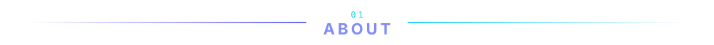</h2>

<p align="center">
  Computer Science Engineering student focused on <b>DevOps</b>, <b>Cloud Engineering</b>, <b>Cybersecurity</b> and <b>AI</b>.<br/>
  I build and experiment with real-world systems using AWS, Docker, Kubernetes, Terraform, Python, Linux and modern development tools,<br/>
  and I enjoy turning ideas into reliable, scalable technology through automation, infrastructure and security.
</p>

<p align="center">
  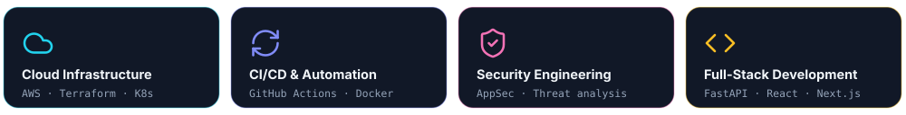
</p>

<br/>

<h2 align="center">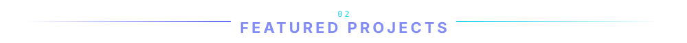</h2>

<table align="center">
  <tr>
    <td width="50%" valign="top">
      <a href="https://portfolio.joelz.site/projects/surl"></a>
      <h3 align="center">Sentinel URL</h3>
      <p align="center">
        
      </p>
      <p align="center">Real-time phishing &amp; threat detection system with intelligent URL analysis</p>
      <p align="center">
        
        
        
        
      </p>
      <p align="center">
        <a href="https://github.com/joeljohngeorge8080/SURL"></a>
        <a href="https://sentinelurl.site"></a>
        <a href="https://portfolio.joelz.site/projects/surl"></a>
      </p>
    </td>
    <td width="50%" valign="top">
      <a href="https://portfolio.joelz.site/projects/dna-stego"></a>
      <h3 align="center">DNA Steganography App</h3>
      <p align="center">
        
      </p>
      <p align="center">Encrypted messages hidden in DNA sequence files, protected with AES-256-GCM or ChaCha20-Poly1305</p>
      <p align="center">
        
        
        
        
      </p>
      <p align="center">
        <a href="https://github.com/joeljohngeorge8080/DNA-STEGO"></a>
        <a href="https://dnastego.joelz.site"></a>
        <a href="https://portfolio.joelz.site/projects/dna-stego"></a>
      </p>
    </td>
  </tr>
  <tr>
    <td width="50%" valign="top">
      <a href="https://portfolio.joelz.site/projects/riskgraph"></a>
      <h3 align="center">RiskGraph</h3>
      <p align="center">
        
      </p>
      <p align="center">Context-aware security risk prioritisation and attack paths</p>
      <p align="center">
        
        
        
        
      </p>
      <p align="center">
        <a href="https://github.com/joeljohngeorge8080/RiskGraph"></a>
        <a href="https://portfolio.joelz.site/projects/riskgraph"></a>
      </p>
    </td>
    <td width="50%" valign="top">
      <a href="https://portfolio.joelz.site/projects/handoff"></a>
      <h3 align="center">HandOff</h3>
      <p align="center">
        
      </p>
      <p align="center">Drag files to the screen edge and they land on nearby computers</p>
      <p align="center">
        
        
        
        
      </p>
      <p align="center">
        <a href="https://github.com/joeljohngeorge8080/HandOff"></a>
        <a href="https://portfolio.joelz.site/projects/handoff"></a>
      </p>
    </td>
  </tr>
  <tr>
    <td width="50%" valign="top">
      <a href="https://portfolio.joelz.site/projects/hma-showcase"></a>
      <h3 align="center">HMA IEMS</h3>
      <p align="center">
        
      </p>
      <p align="center">Portfolio-safe showcase of an enterprise operations platform</p>
      <p align="center">
        
        
        
        
      </p>
      <p align="center">
        <a href="https://github.com/joeljohngeorge8080/hll-internship-project-showcase"></a>
        <a href="https://hll-internship-project.joelz.site"></a>
        <a href="https://portfolio.joelz.site/projects/hma-showcase"></a>
      </p>
    </td>
    <td width="50%" valign="top">
      <a href="https://portfolio.joelz.site/projects/keystone"></a>
      <h3 align="center">Keystone</h3>
      <p align="center">
        
      </p>
      <p align="center">Short-lived cloud credentials for CI, with no standing secrets</p>
      <p align="center">
        
        
        
        
      </p>
      <p align="center">
        <a href="https://github.com/joeljohngeorge8080/keystone"></a>
        <a href="https://portfolio.joelz.site/projects/keystone"></a>
      </p>
    </td>
  </tr>
</table>

<p align="center">
  <a href="https://portfolio.joelz.site/#projects"></a>
</p>

<br/>

<h2 align="center">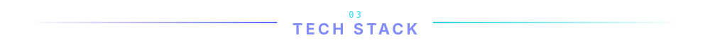</h2>

<!-- Primary Tools -->
<p align="center">
  
  
  
  
  
  
  
  
  
  
</p>

<!-- Full Stack icon grid -->
<p align="center">
  
</p>

<br/>

<h2 align="center">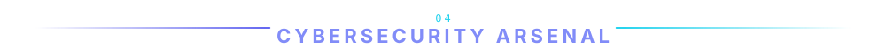</h2>

<p align="center">
  
  
  
  
  
  
  
</p>

<h3 align="center">Certifications</h3>

<p align="center">
  
  
  <br/>
  
  
</p>

<br/>

<h2 align="center">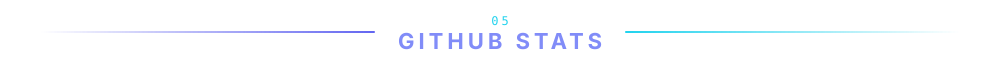</h2>

<table align="center">
  <tr>
    <td>
      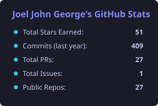
      <br/><br/>
      
    </td>
    <td valign="top">
      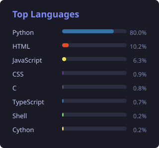
    </td>
  </tr>
</table>

<br/>

<h2 align="center">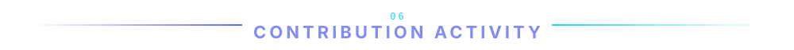</h2>

<p align="center">
  <picture>
    <source media="(prefers-color-scheme: dark)" srcset="https://raw.githubusercontent.com/joeljohngeorge8080/joeljohngeorge8080/output/github-contribution-grid-snake-dark.svg"/>
    <source media="(prefers-color-scheme: light)" srcset="https://raw.githubusercontent.com/joeljohngeorge8080/joeljohngeorge8080/output/github-contribution-grid-snake.svg"/>
    
  </picture>
</p>

<br/>

<h2 align="center">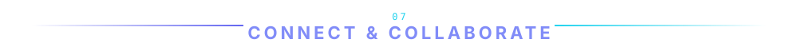</h2>

<p align="center">
  <a href="https://www.linkedin.com/in/joel-john-george-716874287/">
    
  </a>
  <a href="mailto:hmacommunicationsteam@gmail.com">
    
  </a>
  <a href="https://github.com/joeljohngeorge8080">
    
  </a>
  <a href="https://portfolio.joelz.site">
    
  </a>
</p>

<br/>

```
$ whoami
> Joel John George

$ cat availability.txt
> Open to DevOps contracts
> Cloud architecture consulting
> Technical mentoring
> Open source collaboration

$ echo "Let's build something secure."
> Let's build something secure.
```

<!-- Footer -->
<p align="center">
  
</p>
